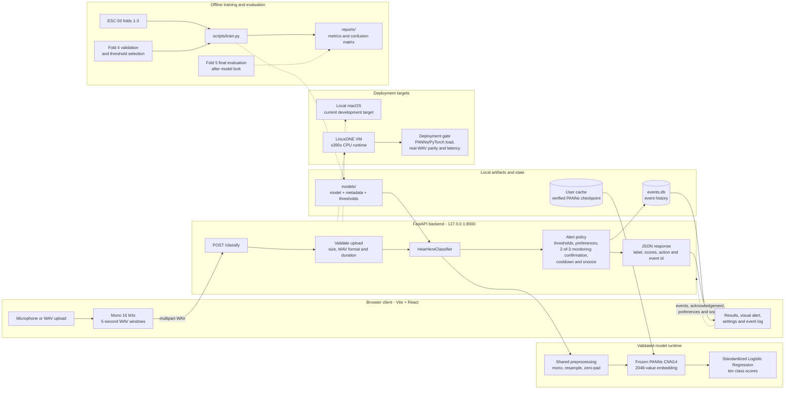

# HearHere Solution Architecture

This diagram shows the implemented flow from an audio input to a visual alert. Local macOS is the active development target; the same backend contract can run on the verified LinuxONE s390x VM after its deployment gates pass.

The request path is `browser -> POST /classify -> shared preprocessing -> PANNs embedding -> Logistic Regression scores -> backend alert policy -> browser response`. The backend owns alert decisions and event state; the frontend displays the returned `action` and scores.

Model scores are uncalibrated classifier scores rather than real-world event probabilities. Fold 4 selects thresholds, while Fold 5 is reserved for the final held-out report. The current model recognises ten classes and keeps the six alert-oriented classes configurable through the backend policy.

Related contracts:

- [Current API contract](classify_api.md)
- [Model artifact contract](model-artifacts.md)
- [Project structure](project-structure.md)
- [LinuxONE loading and smoke-test guide](linuxone.md)
